<!-- Every card is an animated SVG drawn by scripts/render_readme_cards.py and refreshed daily by
     .github/workflows/readme-cards.yml. Spacing is baked into the SVGs, so keep this block free of
     blank lines and keep each row of three on one line with no spaces between the images. -->

 
 
 
 
<picture><source media="(prefers-color-scheme: dark)" srcset="./cards/title-building-dark.svg" /></picture> 

<a href="https://yrmn.me">yrmn.me</a> &nbsp;/&nbsp; <a href="https://www.linkedin.com/in/oleksand4r/">linkedin</a> &nbsp;/&nbsp; <a href="https://t.me/oleksand4r">telegram</a> &nbsp;/&nbsp; <a href="https://t.me/yrmn_design">channel</a>

